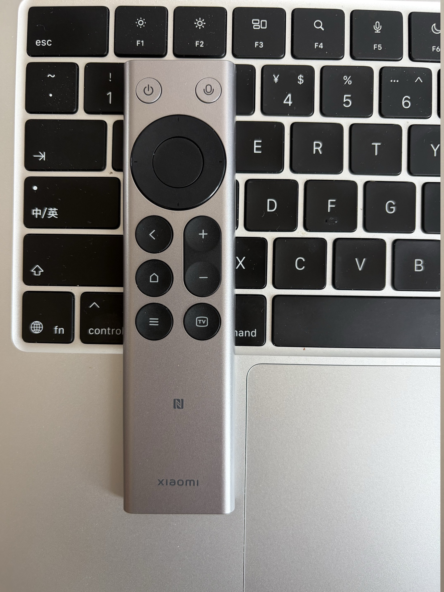
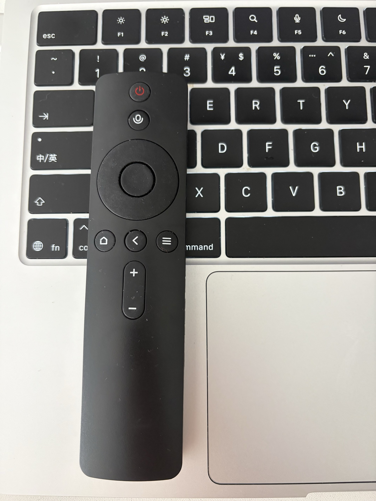

# 蓝牙遥控器 macOS 原生按键映射

[](LICENSE)
[](https://support.apple.com/macos)

这是一个原生 macOS 菜单栏程序，使用 `IOHIDManager` 发现经典蓝牙和 BLE HID 遥控器。用户必须在控制面板明确选择当前设备；程序不会自动接管未知设备。

程序提供轻量控制面板：显示连接和权限状态、引导打开 macOS 权限设置、查看当前映射、通过按键学习依次添加映射、重新连接、打开日志和设置登录启动。完成设置后可关闭窗口，程序继续在菜单栏后台运行。

程序采用共享读取，并由程序自身调用系统 `hidutil`，按照所选设备的 `PhysicalDeviceUniqueID`，仅将已配置且需要重映射的来源按键映射到 HID Reserved。未选择的蓝牙 HID 设备不会被拦截、记录或映射。退出程序时会清空程序设置的抑制映射。

## 小米遥控器默认模板

| 遥控器输入 | HID usage | 输出动作 |
| --- | ---: | --- |
| 返回键 | 特殊键 · `7:241` | 删除键 |
| 语音键 | F5 · `7:62` | Fn 按下/松开 |
| 主页键 | Home · `7:74` | 保持原按键，不拦截 |
| 菜单键 | Application · `7:101` | 将 Codex 调到前台，并调用 Codex 原生输入框聚焦命令 |
| 直播键 | `` ` / ~ `` · `7:53` | 保持原按键，不拦截 |
| 电源键 | Power · `7:102` | macOS Power 系统事件重放 |

返回键短按产生一次 Delete；按住超过 macOS 的按键重复延迟后，会按系统当前重复速度连续删除，松开、断连、睡眠或退出时立即停止。

经过识别的小米语音遥控器会自动使用上表模板。其他蓝牙 HID 遥控器从空配置开始，不会套用小米键位。“配置按键…”中的动作包括 Tab、Escape、Page Up、Page Down、Space、Return、Mission Control、显示桌面、Spotlight、播放/暂停、静音、Delete、Fn 和 Codex 等。Return 可能确认当前操作或发送内容，因此列表中带有风险提示。

## 自助配置按键

在控制面板选择遥控器，打开“配置按键…”，点击“开始识别按键”，然后依次按下遥控器按键。配置页会新增或定位对应 HID usage；可以直接修改键名（例如“返回键”）、选择功能或删除映射。重复按同一键不会产生重复项目。

识别期间，程序只记录当前遥控器输入，不执行已知按键的原功能或已有映射；停止识别或关闭配置页后立即恢复。首次发现的未知按键默认设为“仅记录日志”，避免尚未选择功能时产生意外操作。

每只遥控器都有独立的本机配置档案，包含设备名称、设备唯一标识和完整映射。切换遥控器时自动恢复上次配置；这些数据保存在 `~/Library/Application Support/XiaomiRemoteRemapper/config.json`，不会写入遥控器或上传网络。公开 Issue 或日志时仍应删除设备唯一标识。

“显示桌面”、Mission Control 和 Spotlight 会在每次触发时读取 macOS 当前系统快捷键并发送完整组合键；用户只需按对应遥控器按键，无需同时操作 Mac 键盘。若系统没有保存有效的自定义配置，则分别回退到 Apple 默认的 `Fn-H`、`Control-↑` 与 `Command-Space`。如果用户在系统设置中明确禁用了对应快捷键，程序不会绕过该设置强行触发，并会在日志中记录跳过原因。

Power 需要特别说明：原始 HID 报告被设备精确抑制后不会再进入系统，因此这里是 `NX_SYSDEFINED/NX_POWER_KEY` 重放，并非字节级透传。请先验证短按行为，不要直接连续或长按 Power。

## 支持范围

- 最低系统：macOS 13。
- 通用发现范围：IOHID 中 Transport 为经典蓝牙、`Bluetooth Low Energy` 或 `BluetoothLowEnergy`，并提供 `PhysicalDeviceUniqueID` 的 HID 设备。
- 已完成真实按键验证：系统产品名为“小米蓝牙语音遥控器”和“小米蓝牙语音遥控器2.8”的型号，VID `10007` / PID `12984`。
- 使用前必须先在 macOS“系统设置 → 蓝牙”中完成配对；程序不负责蓝牙扫描或配对。
- 同时连接多个蓝牙 HID 设备时，可在控制面板明确选择遥控器；不要选择日常使用的键盘或鼠标。
- 不同型号可能使用键盘页、Consumer 页或其他 HID usage；可通过学习模式扩展。缺少稳定 `PhysicalDeviceUniqueID` 的设备暂不列入可选范围。
- Karabiner、其他 HID 映射程序和旧 `hidutil UserKeyMapping` 可能造成抢占、双触发或无响应。仅关闭 Karabiner 规则并不一定会释放设备；还需在 Karabiner-Elements 的 Devices 页面关闭遥控器的 “Modify events”，使 Karabiner 忽略该设备。
- Codex 聚焦功能依赖 `com.openai.codex` 当前版本的原生 Escape 聚焦行为；程序不会移动鼠标或点击屏幕坐标。Codex 界面行为更新后可能需要调整。

## 安装

macOS 对应的双击应用是 `.app`，推荐分发形式是 `.dmg`：

1. 双击 `XiaomiRemoteRemapper.dmg`。
2. 将 `XiaomiRemoteRemapper.app` 拖到 `Applications`。
3. 从“应用程序”中双击启动。
4. 按控制面板提示授予“输入监控”和“辅助功能”权限。
5. 权限打开后回到程序，状态会自动刷新；必要时点“重新连接”。

输入监控用于读取指定遥控器的 HID 输入；辅助功能用于发送映射后的键盘/系统事件，以及聚焦 Codex 输入框。macOS 不允许发行者预先授予这两项权限，每台 Mac 都需要用户自行确认。

本机自签名或 ad-hoc 构建不受其他 Mac 信任，Gatekeeper 可能阻止直接打开。面向普通用户的 Release 应使用 Developer ID 签名并经 Apple 公证。

## 本地构建

本地构建后可直接获得两种可双击产物：

```bash
./scripts/check.sh
open dist/XiaomiRemoteRemapper.dmg
```

`check.sh` 会执行 debug/release 编译、51 项内置自检、App bundle 打包、签名、DMG 打包和镜像校验。生成物为：

- `dist/XiaomiRemoteRemapper.app`
- `dist/XiaomiRemoteRemapper.dmg`
- `dist/XiaomiRemoteRemapper.dmg.sha256`

也可以不经过 DMG，直接双击或运行：

```bash
open dist/XiaomiRemoteRemapper.app
```

公开版 Bundle ID 固定为 `io.gitee.bd3nd.xiaomi-remote-remapper`。本机开发如需复用已有的 macOS 权限身份，可以仅在构建命令中覆盖，不要把个人标识提交到仓库：

```bash
BUNDLE_IDENTIFIER=your.bundle.identifier ./scripts/check.sh
```

长期迭代时可创建仅保存在本机登录钥匙串中的代码签名身份。脚本不会把证书私钥写入仓库：

```bash
./scripts/create-local-signing-identity.sh
./scripts/check.sh
```

创建后，`build-app.sh` 会自动优先使用 `XiaomiRemoteRemapper Local Code Signing`，避免每次构建因 ad-hoc 哈希变化而重新创建权限身份。

## 公开发行

本机自签名身份适合长期自用，但其他 Mac 不会自动信任它。公开发布并实现正常双击安装，需要 Apple Developer ID 签名、安全时间戳和公证：

```bash
SIGN_IDENTITY="Developer ID Application: Example" \
NOTARY_PROFILE="notary-profile" \
./scripts/build-dmg.sh
```

`NOTARY_PROFILE` 应由维护者预先使用 `xcrun notarytool store-credentials` 保存在本机钥匙串，不能提交到仓库。脚本会提交 DMG、公证并装订票据；未提供该变量时只创建本地 DMG，不执行联网公证。上传 Release 前应在一台未安装过本程序的 Mac 上验证 Gatekeeper、权限引导、蓝牙首次绑定和登录启动。

可用应用本身的身份检查当前权限与设备选择：

```bash
dist/XiaomiRemoteRemapper.app/Contents/MacOS/XiaomiRemoteRemapper --diagnostics
```

需要以 App 自身身份重新登记两项权限时，可通过 LaunchServices 请求：

```bash
open -n dist/XiaomiRemoteRemapper.app --args --request-permissions
```

排查系统对管理器和单设备打开路径的差异：

```bash
open -n dist/XiaomiRemoteRemapper.app --args --probe-hid-open
```

安装到 `/Applications` 后可登记或取消登录启动：

```bash
open -n /Applications/XiaomiRemoteRemapper.app --args --enable-login-item
open -n /Applications/XiaomiRemoteRemapper.app --args --disable-login-item
```

从终端直接执行 `--diagnostics` 时，macOS 可能把终端或调用进程视为权限负责进程；最终应以正常启动后的菜单状态和日志中的 HID 打开结果为准。

程序首次运行后：

1. 控制面板会显示“输入监控”和“辅助功能”的实时状态。
2. 点“请求权限”；如 macOS 没有自动进入对应页面，再点“打开系统设置”。
3. 在“使用遥控器”中明确选择目标蓝牙 HID 设备，不要选择日常键盘或鼠标。
4. 点“配置按键…”后开始识别，可修改键名、动作或删除映射；修改后立即保存并安全重连。
5. 权限或登录启动状态变化后，如状态未立即刷新，可点“重新连接”。

配置保存在 `~/Library/Application Support/XiaomiRemoteRemapper/config.json`，日志保存在 `~/Library/Logs/XiaomiRemoteRemapper/app.log`。未配置的 usage 会完整记录在日志中。

## 隐私

- 程序没有网络请求、遥测、账户系统或云端存储。
- `IOHIDManager` 会发现蓝牙 HID 设备，但输入回调会先按 `PhysicalDeviceUniqueID` 过滤；未选择设备的输入不会记录或映射。用户不应选择日常键盘或鼠标。
- 配置和日志仅保存在当前用户的 Mac 上。
- 日志可能包含 HID usage、设备产品名和设备唯一标识。提交 Issue 或日志前，请先删除设备标识、用户名、本机路径和其他识别信息。
- 本项目不需要完全磁盘访问权限。

## 从 Karabiner / hidutil 迁移

先保持旧方案不变，确认新 App 已通过构建和自检：

```bash
./scripts/migrate-legacy.sh --check
```

准备开始原生程序测试时再执行：

```bash
./scripts/migrate-legacy.sh --apply
```

该操作会先备份旧 LaunchAgent、旧脚本和 Karabiner 配置，然后停止旧 LaunchAgent，并清空物理遥控器与 Karabiner 虚拟键盘的两层 `UserKeyMapping`。旧标签可在运行时指定，例如 `LEGACY_LAUNCH_AGENT_LABEL=com.local.xiaomi-remote-hidutil ./scripts/migrate-legacy.sh --apply`。脚本不会自动改写 Karabiner JSON；请在 Karabiner-Elements 的 Devices 页面关闭该遥控器的 “Modify events”，使 Karabiner 忽略该设备，再启动本程序。仅停用旧规则不够，因为 Karabiner Core Service 仍可能独占 HID 设备。




## 真实设备验收清单

- 返回键短按只产生一次 Delete；长按按系统速度连续删除，松开、断连、睡眠和退出后立即停止。
- F5 按住时，能与 MacBook 内置键盘的按键形成 Fn 组合；松开或蓝牙断开后不残留 Fn 状态。
- Home 和反引号不进入抑制映射，保持系统收到的原始行为。
- Application 唤起已安装的 `com.openai.codex`，并调用 Codex 原生 Escape 聚焦行为；不移动鼠标、不依赖输入框位置。
- Power 短按行为与原始系统行为一致；长按、重复 HID down 报告不会被重复重放。
- 蓝牙断开和重连后自动恢复，不需要退出程序。
- 睡眠/唤醒、锁屏、解锁、快速切换用户后，连接状态与权限状态正确；唤醒后会等待蓝牙恢复，并使用共享读取模式重新连接。
- 遥控器原始输入和映射输出没有双触发。

设备不在线时只能完成构建、配置和生命周期路径验证；上述硬件行为必须在遥控器连接后逐项观察日志和实际系统响应。

## 卸载

1. 从菜单栏退出程序，并在控制面板关闭“登录时自动启动”。
2. 将 `/Applications/XiaomiRemoteRemapper.app` 移到废纸篓。
3. 如需删除本地数据，移除以下内容：

   ```bash
   rm -rf "$HOME/Library/Application Support/XiaomiRemoteRemapper"
   rm -rf "$HOME/Library/Logs/XiaomiRemoteRemapper"
   ```

4. 如果程序未正常退出，小米遥控器的旧版广域映射可用下列命令清空；其他设备应按其 `PhysicalDeviceUniqueID` 精确清空：

   ```bash
   hidutil property --matching '{"VendorID":10007,"ProductID":12984}' --set '{"UserKeyMapping":[]}'
   ```

5. 如需让 macOS 忘记权限记录，可执行：

   ```bash
   tccutil reset ListenEvent io.gitee.bd3nd.xiaomi-remote-remapper
   tccutil reset Accessibility io.gitee.bd3nd.xiaomi-remote-remapper
   ```

## 参与贡献与安全问题

贡献方式见 [CONTRIBUTING.md](CONTRIBUTING.md)，安全问题报告方式见 [SECURITY.md](SECURITY.md)，版本变化见 [CHANGELOG.md](CHANGELOG.md)。

## 许可证与非官方声明

本项目采用 [MIT License](LICENSE)，Copyright (c) 2026 BD3ND。

本项目为社区非官方项目，与小米、Apple、OpenAI 或其他设备厂商无隶属、合作或背书关系。相关商标归各自权利人所有。
